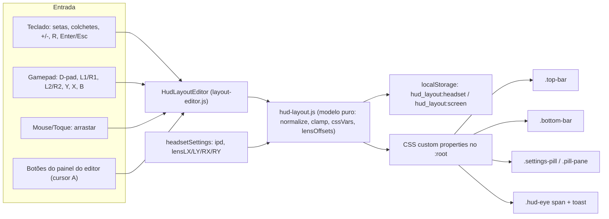

# Plano: Olho dominante, HUD ajustável, barra compacta e melhorias de UX (Modo Óculos)

## Contexto e diagnóstico

| # | Problema relatado | Causa raiz encontrada |
|---|---|---|
| 1 | Com olho dominante Esq./Dir. o menu vai para o centro do app | Em [style.css:L521-560](file:///c:/Users/djowt/Downloads/vrplayer/css/style.css#L521-L560) e [L1185-1192](file:///c:/Users/djowt/Downloads/vrplayer/css/style.css#L1185-L1192) o painel do olho oposto é escondido com `display:none`. Os contêineres usam `justify-content: space-evenly` (sheet de Formato, pílula) e `flex:1` (`.hud-eye`), então **o painel que sobra se recentraliza na tela inteira**, em cima da divisão entre as lentes. O cursor do gamepad ([cursor.js:L454-460](file:///c:/Users/djowt/Downloads/vrplayer/js/cursor.js#L454-L460)) continua clicando na metade do olho dominante, então o menu fica inutilizável. |
| 1b | (achado extra) Mesmo com "Ambos", os painéis não ficam centrados nas lentes | Com `space-evenly` + `max-width:420px`, o centro de cada painel fica em `(W-2w)/3 + w/2`, e não em `W/4` / `3W/4`. O menu fica deslocado em relação ao centro óptico. |
| 2 | HUD de controles cortado pelo óculos | No modo óculos, `.controls-pane` usa `justify-content: space-between` com padding fixo de 12-14px ([L418-431](file:///c:/Users/djowt/Downloads/vrplayer/css/style.css#L418-L431)). As barras ficam grudadas nas bordas, onde a lente corta. |
| 3 | Barra de funções larga e esticada | A `.top-bar` junta ✕ + título + **9 ícones** numa linha só (até 440px por olho). |
| 4a | (achado extra) Toast aparece na divisão dos olhos | O `#toast` é um elemento único com `left:50%` ([L1381-1398](file:///c:/Users/djowt/Downloads/vrplayer/css/style.css#L1381-L1398)). |

---

## User Review Required

> [!IMPORTANT]
> **Novo perfil padrão do Modo Óculos.** Para resolver o corte "de fábrica", o perfil padrão do óculos vem com **Margem segura = 8%**, o que puxa todos os HUDs para dentro da área visível da lente. O Modo Tela continua com 0% (visual atual). Quem quiser o visual antigo pode zerar no editor.

> [!WARNING]
> **Arrastar com o cursor do gamepad não é suportado.** O cursor virtual dispara só cliques (`pointerdown/up`), não arrasto contínuo. No gamepad, os HUDs se movem com **D-pad / analógico esquerdo**. Arrastar fica disponível para mouse e toque.

## Open Questions

> [!IMPORTANT]
> 1. **Atalhos para abrir o editor:** proponho a tecla **`G`** (livre hoje) e **segurar Y/Triângulo por 1,2 s** no gamepad. O toque curto em Y continua centralizando a visão, como hoje. Pode ser assim?
> 2. **Margem segura padrão do óculos:** 8% está bom como ponto de partida, ou prefere outro valor?

---

## Visão geral da arquitetura



O layout é aplicado **só via variáveis CSS** (`translate`/`scale`/`padding`). Assim não mexemos nas animações de `transform` que já existem (show/hide) e não precisamos de JS no loop de render.

---

## Proposed Changes

### Componente 1: correção do Olho Dominante e centralização nas lentes (Problema 1)

#### [MODIFY] [style.css](file:///c:/Users/djowt/Downloads/vrplayer/css/style.css)

**a) Trocar `display:none` por `visibility:hidden`** no painel do olho oposto. O espaço continua reservado, então o painel dominante fica na própria metade. `visibility:hidden` também bloqueia ponteiro, o que é o comportamento esperado.

```diff
 #player.headset.dominant-left .controls-pane.right {
-  display: none !important;
+  visibility: hidden !important;
 }
-#player.headset.dominant-left .controls-pane.left {
-  border-right: none !important;
-  width: 50% !important;
-  max-width: 50% !important;
-  margin: 0 !important;
-}
 #player.headset.dominant-left .hud-eye.right,
 #player.headset.dominant-left .settings-pill .pill-pane.right {
-  display: none !important;
+  visibility: hidden !important;
 }
-#player.headset.dominant-left .settings-pill {
-  justify-content: flex-start !important;
-  padding-left: 6% !important;
-}
 /* (espelho idêntico para dominant-right) */

-body.dominant-left #sheet-format .sheet-pane.right { display: none !important; }
+body.headset-mode.dominant-left #sheet-format .sheet-pane.right,
+body.headset-mode.dominant-right #sheet-format .sheet-pane.left { visibility: hidden !important; }
```

**b) Grid de duas colunas exatas (50/50)** na pílula e na sheet de Formato no modo óculos, para que cada painel fique **exatamente centrado na sua lente** (corrige o 1b):

```diff
 body.headset-mode #sheet-format .sheet-split-container {
-  display: flex;
-  justify-content: space-evenly;
+  display: grid;
+  grid-template-columns: 1fr 1fr;
+  justify-items: center;
+  align-items: center;
 }
 #player.headset .settings-pill {
-  display: flex;
-  justify-content: space-evenly;
+  display: grid;
+  grid-template-columns: 1fr 1fr;
+  justify-items: center;
 }
```

O mesmo vale para o toast (Componente 4). `.hud` e `.controls` já são 50/50 e só precisavam da troca para `visibility`.

---

### Componente 2: modelo de layout (núcleo testável)

#### [NEW] [hud-layout.js](file:///c:/Users/djowt/Downloads/vrplayer/js/ui/hud-layout.js)

Módulo puro, sem DOM, coberto por testes unitários.

```js
export const HUD_ELEMENTS = [
  { id: 'top',    label: 'Barra de funções' },
  { id: 'bottom', label: 'Controles do vídeo' },
  { id: 'pill',   label: 'Pílula de ajustes' },
  { id: 'hud',    label: 'Mensagens' },
];
export const AUTO_HIDE_OPTIONS = [2000, 3500, 5000, 8000, 0]; // 0 = nunca
export const LIMITS = { pos: 40, scaleMin: 0.6, scaleMax: 1.4, safeMax: 20, opacityMin: 0.4 };

export function defaultLayout(mode /* 'headset' | 'screen' */) {
  return {
    version: 1,
    safeMargin: mode === 'headset' ? 8 : 0, // % da metade/tela
    opacity: 1,
    autoHideMs: 3500,
    followLens: false,
    elements: Object.fromEntries(HUD_ELEMENTS.map(e => [e.id, { x: 0, y: 0, scale: 1 }])),
  };
}
export function normalizeLayout(raw, mode) { /* merge com default + clamp de tudo; ignora lixo */ }
export function moveElement(layout, id, dx, dy) { /* retorna novo layout com clamp */ }
export function scaleElement(layout, id, dir) { /* passo 0.05, clamp */ }
export function resetElement(layout, id, mode) { /* volta o elemento ao padrão */ }

// Converte o centro óptico do shader (projections.js L196) em offset do HUD (% do painel).
// Shader: centerL = (0.5 - ipd + lensLX, 0.5 + lensLY), com UV.y crescendo para cima.
export function lensOffsets(hs = {}) {
  return {
    l: { x: (-(hs.ipd || 0) + (hs.lensLX || 0)) * 100, y: -(hs.lensLY || 0) * 100 },
    r: { x: ((hs.ipd || 0) + (hs.lensRX || 0)) * 100,  y: -(hs.lensRY || 0) * 100 },
  };
}

export function layoutToCssVars(layout, { headset, lens }) {
  // → { '--hud-pane-w': '50vw', '--hud-safe': '8', '--hud-opacity': '1',
  //     '--hud-top-x': '0', '--hud-top-y': '0', '--hud-top-s': '1', ...,
  //     '--hud-lens-l-x': '1.2', ... }   (lens zerado se !followLens ou !headset)
}
```

#### [NEW] [hud-layout.test.js](file:///c:/Users/djowt/Downloads/vrplayer/tests/hud-layout.test.js)

Testes com `node:test`, no mesmo padrão de `format.test.js`:
- `normalizeLayout` com `null`, JSON corrompido, valores fora do limite e chaves extras.
- `moveElement`/`scaleElement` respeitando os limites.
- `lensOffsets`: sinais corretos do IPD e inversão do eixo Y.
- `layoutToCssVars`: `--hud-pane-w` = `50vw` no óculos e `100vw` na tela; lente zerada quando `followLens=false`.

#### [MODIFY] [package.json](file:///c:/Users/djowt/Downloads/vrplayer/package.json)
Adicionar `tests/hud-layout.test.js` ao script `test` e `node --check` de `js/ui/hud-layout.js`, `js/ui/layout-editor.js` e do teste ao script `check`.

---

### Componente 3: aplicação do layout via CSS (Problema 2)

#### [MODIFY] [style.css](file:///c:/Users/djowt/Downloads/vrplayer/css/style.css)

Uso as propriedades individuais `translate`/`scale`, que se somam ao `transform` existente sem quebrar as animações:

```css
:root {
  --hud-pane-w: 100vw; --hud-safe: 0; --hud-opacity: 1;
  --hud-lens-l-x: 0; --hud-lens-l-y: 0; --hud-lens-r-x: 0; --hud-lens-r-y: 0;
}
/* offset por olho (Seguir centro óptico) */
.controls-pane.left,  .pill-pane.left,  .hud-eye.left,  .toast-eye.left  { --eye-x: var(--hud-lens-l-x); --eye-y: var(--hud-lens-l-y); }
.controls-pane.right, .pill-pane.right, .hud-eye.right, .toast-eye.right { --eye-x: var(--hud-lens-r-x); --eye-y: var(--hud-lens-r-y); }

.top-bar {
  translate: calc((var(--hud-top-x, 0) + var(--eye-x, 0)) * var(--hud-pane-w) / 100)
             calc((var(--hud-top-y, 0) + var(--eye-y, 0)) * 1vh);
  scale: var(--hud-top-s, 1);
  transform-origin: top center;
  opacity: var(--hud-opacity);
}
/* .bottom-bar (origin bottom), .pill-pane / .settings-pill, .hud-eye span, .toast-eye: análogos */

#player.headset .controls-pane {
  padding: calc(var(--safe-t) + 12px + var(--hud-safe) * 1vh)
           calc(16px + var(--hud-safe) * var(--hud-pane-w) / 100)
           calc(var(--safe-b) + 14px + var(--hud-safe) * 1vh);
}
#player.headset .settings-pill { bottom: calc(20% + var(--hud-safe) * 1vh); }
/* Modo tela: top/left/right da .top-bar e bottom da .bottom-bar somam a margem */
```

---

### Componente 4: editor interativo de layout (Problema 2 + sugestões)

#### [NEW] [layout-editor.js](file:///c:/Users/djowt/Downloads/vrplayer/js/ui/layout-editor.js)

Classe `HudLayoutEditor` que recebe dependências injetadas (`store`, `getMode`, `getHeadsetSettings`, `hud`, `onLayoutChange`, `setControlsVisible`), para não acoplar ao `app.js`.

**Ao abrir o editor:**
- Adiciona `layout-editing` ao `#player` e força os controles visíveis (sem auto-ocultar).
- Mostra uma **prévia** da pílula e de uma mensagem de exemplo, para que tudo seja posicionável.
- O elemento selecionado ganha contorno tracejado azul e uma etiqueta com o nome.
- O painel do editor aparece no **centro de cada olho** (respeitando o olho dominante), no lugar do `big-play`. É renderizado por template nos dois painéis e os cliques usam delegação por `data-action`, sem a gambiarra de proxy usada na sheet de Formato.

```
┌──────────── Editar Layout ────────────┐
│  ◀  Controles do vídeo  ▶    X+0 Y-6  │
│  Escala  [−] 100% [+]                 │
│  Margem segura   [−] 8%  [+]          │
│  Opacidade       [−] 100% [+]         │
│  Auto-ocultar    [ 3,5 s ▾ ]          │
│  [◎ Seguir centro óptico: OFF]        │
│  [↺ Restaurar elemento] [↺ Tudo]      │
│              [ ✓ Concluir ]           │
└───────────────────────────────────────┘
```

**Controles:**

| Ação | Gamepad | Teclado | Mouse/Toque |
|---|---|---|---|
| Abrir editor | Segurar **Y** 1,2 s | **G** | Botão 📐 na barra / item na sheet de Formato |
| Trocar elemento | **L1 / R1** | **[ / ]** ou Tab | Clicar no elemento |
| Mover | **D-pad** (repete ao segurar) / analógico esq. | **Setas** (Shift = 5×) | **Arrastar** |
| Escala do elemento | **L2 / R2** | **− / +** | Botões −/+ |
| Restaurar elemento | **Y** | **R** | Botão |
| Seguir centro óptico | **X** | **C** | Botão |
| Salvar e sair | **B / Start / Select** | **Enter / Esc / G** | ✓ Concluir |

- **Perfis separados**: `hud_layout:headset` e `hud_layout:screen`, salvos automaticamente a cada alteração. `setHeadset()` troca o perfil aplicado.
- **Seguir centro óptico**: quando ligado, os HUDs de cada olho acompanham `ipd + lensLX/LY/RX/RY`, ao vivo, também quando a calibração é ajustada na pílula.
- **Restaurar**: restaura o elemento selecionado ou o perfil inteiro do modo atual.

#### [MODIFY] [gamepad.js](file:///c:/Users/djowt/Downloads/vrplayer/js/gamepad.js)
- Novo modo `isLayoutEditorActive()`, verificado **antes** do modo pílula em `_handleStandardButton` e `_handleGenericButton`, com o mapeamento da tabela. Reaproveita a lógica de repetição de `_handleRepeatablePillAdjust`.
- `_updateAxes`: quando o editor está ativo, o analógico esquerdo chama `onLayoutMove(dx, dy)` (com dt) em vez de girar a visão.
- Atalho: Y segurado ≥ 1,2 s → `onOpenLayoutEditor()`, disparando uma vez por pressão (flag resetada ao soltar).

#### [MODIFY] [app.js](file:///c:/Users/djowt/Downloads/vrplayer/js/app.js)
- Importa os módulos e instancia `layoutEditor`. Aplica o perfil no `init()` e em `setHeadset()`.
- `initGamepad()`: adiciona os callbacks do editor. `isUiActive` do cursor passa a considerar o editor.
- `scheduleHide()`: troca o `3500` fixo por `layout.autoHideMs` (`0` = nunca ocultar).
- Handler de teclado: `if (layoutEditor.isOpen() && layoutEditor.handleKey(e)) return;` no início, e a tecla `G` abre o editor.
- Quando `headsetSettings` mudar (pílula/presets), chama `layoutEditor.refreshLens()`.
- `document.querySelectorAll('#controls .btn-layout')` → `layoutEditor.open()`, no mesmo padrão de `.btn-settings` ([L2700](file:///c:/Users/djowt/Downloads/vrplayer/js/app.js#L2700)).
- `toast()` passa a escrever nos dois `.toast-eye`.

---

### Componente 5: barra de funções compacta em 2 linhas, só no Modo Óculos (Problema 3)

#### [MODIFY] [index.html](file:///c:/Users/djowt/Downloads/vrplayer/index.html)
- Novo botão `btn-layout` (ícone `#i-layout`, adicionado ao sprite SVG) nos dois painéis. São **10 ícones = grade 5×2**.
- Item na sheet de Formato: "📐 Editar Layout dos Menus (HUD)".
- Toast reestruturado: `<div id="toast" class="toast"><span class="toast-eye left glass"></span><span class="toast-eye right glass"></span></div>`.

#### [MODIFY] [style.css](file:///c:/Users/djowt/Downloads/vrplayer/css/style.css)

```
Antes (por olho, ~440px):
[✕][ Título…… ][⌖][−][+][∿][⛶][▭][🔖][⚙][🥽]

Depois (por olho, ~232px):
[✕][ Título do vídeo… ]
[⌖][ − ][ + ][ ∿ ][ ⛶ ]
[▭][🔖][ ⚙ ][🥽][ 📐 ]
```

```css
#player.headset .top-bar { flex-wrap: wrap; max-width: 232px; gap: 6px; }
#player.headset .title   { flex: 1 1 0; }
#player.headset .top-actions {
  flex-basis: 100%;
  display: grid; grid-template-columns: repeat(5, 1fr);
  justify-items: center; border-radius: 16px; padding: 4px;
}
#player.headset .bottom-bar { max-width: 340px; } /* era 440px */
```

No Modo Tela, a barra continua igual (com o botão 📐 a mais).

---

### Componente 6: documentação

#### [MODIFY] [MANUAL_DE_USO.md](file:///c:/Users/djowt/Downloads/vrplayer/MANUAL_DE_USO.md)
Nova seção "Editor de Layout dos HUDs", atalhos (`G`, segurar Y) na tabela de comandos e atualização do texto de Olho Dominante.

---

## Verification Plan

### Automated Tests
```powershell
npm run check   # sintaxe de todos os módulos (inclui os novos)
npm test        # suíte existente + tests/hud-layout.test.js
```

### Verificação no navegador (subagente)
Servidor local (`npm start`), abrir um vídeo de teste e ativar o Modo Óculos (tecla `V`):
1. **Olho dominante:** para Esquerdo/Direito/Ambos, abrir a sheet de Formato, a pílula (`S`) e disparar um HUD (`E`). Medir via `getBoundingClientRect()` que o centro de cada painel visível fica a **25% / 75% da largura (±2px)**. Tirar screenshots.
2. **Barra compacta:** confirmar a grade 5×2 e largura ≤ 232px por olho.
3. **Editor:** abrir com `G`, mover os Controles com as setas, mudar escala/margem, recarregar a página e confirmar que persistiu. Alternar para o Modo Tela e confirmar que o perfil é independente.
4. **Toast** no modo óculos: um por olho, nenhum na divisão central.
5. Gravação do fluxo para o walkthrough.

### Manual Verification (usuário, no celular + óculos)
- Confirmar que nenhum HUD fica cortado com a margem padrão de 8%.
- Testar o editor com o gamepad: segurar Y, L1/R1, D-pad, L2/R2 e B para sair.
- Ligar "Seguir centro óptico", ajustar `Centro Óptico Esq. X` na pílula e ver os HUDs acompanharem.
